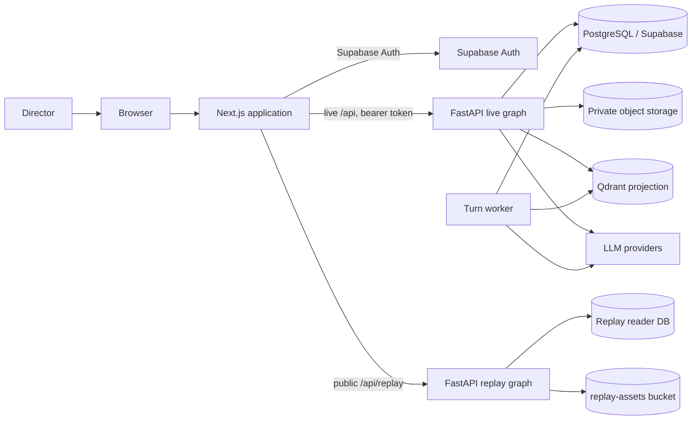

<div align="center">

# Sabha

**A multi-agent advisory board for consequential decisions.**

[**Live project →**](https://sabha-ai-as.vercel.app/) · [**Architecture**](#architecture)

[](https://sabha-ai-as.vercel.app/)
[](https://sabha-ai-as.vercel.app/)

[](https://nextjs.org/)
[](https://react.dev/)
[](https://fastapi.tiangolo.com/)
[](https://www.postgresql.org/)
[](https://qdrant.tech/)

</div>

Sabha is a multi-agent advisory board for consequential decisions. A human director convenes a meeting, chooses a roster of AI participants, and decides who speaks next. Each participant has a distinct mandate, a versioned prompt, and access to shared meeting material plus its own private knowledge stack. Disagreement and consensus are recorded as first-class outcomes, not buried in chat text.

The product has two surfaces:

| Surface | Audience | What it is |
|---|---|---|
| **Live workspace** | The configured operator | A private board room for creating meetings, managing the roster, uploading evidence, running turns, and closing with a summary. |
| **Guided replay** | Anyone, no account required | A read-only reconstruction of a recorded meeting, served from a pinned package. [Open the project →](https://sabha-ai-as.vercel.app/) |

Sabha is deliberately not an auto-facilitator. The director drives the agenda and turn order; the system makes the work durable, attributable, and inspectable.

---

## Contents

- [Architecture](#architecture)
- [Why Sabha](#why-sabha)
- [How it works](#how-it-works)
- [Stack](#stack)
- [Repository layout](#repository-layout)
- [Quick start](#quick-start)
- [Configuration](#configuration)
- [Database, migrations, and access](#database-migrations-and-access)
- [API surface](#api-surface)
- [Recorded replay](#recorded-replay)
- [Testing and acceptance](#testing-and-acceptance)
- [Operations](#operations)
- [Status and release gates](#status-and-release-gates)
- [Limitations](#limitations)
- [Roadmap and deferred work](#roadmap-and-deferred-work)
- [Contributing](#contributing)
- [License](#license)

---

## Architecture

Sabha separates the live advisory workspace from the recorded replay at the request boundary. The browser uses Supabase only for authentication; every meeting, document, turn, and evidence read flows through FastAPI.



| Plane | Owns | Isolation |
|---|---|---|
| **Live API** | Meetings, roster, knowledge, settings, turn admission, closing | Operator bearer token, then the demo write guard; `Cache-Control: private, no-store` |
| **Turn worker** | Claims and executes admitted turns | Same production container, no HTTP; Postgres lease and fence |
| **Replay API** | Published meetings, turns, events, evidence, and assets | Separate GET-only graph and database reader; no fallback to live data |

`backend/main.py` builds the live app from `app.bootstrap`: one Supabase client, meeting service, turn queue service, closing service, and optional turn runner behind a protected router. `backend/worker.py` runs the same container without HTTP and refuses `REPLAY_ONLY=true`. `app.replay` has its own contracts, reads, streaming, cache, and package loader.

The browser never receives a database, storage, or vector credential.

---

## Why Sabha

Most multi-agent chat demos put several models in a loop and let them talk until a token budget runs out. Sabha starts from a different premise: a board meeting has a chair, an agenda, a record, and evidence.

- **The director chooses the next speaker.** There is no hidden facilitator and no automatic round-robin.
- **Every participant has a mandate.** Investor, CTO, and Analyst are built-in templates; custom personas are supported with versioned prompts.
- **Knowledge is scoped.** Meeting documents are shared with the room. Persona and knowledge-stack documents are private to the participants assigned to them.
- **Turns survive failure.** A submitted turn is a durable operation in Postgres, not an HTTP request held open until a model replies.
- **Conflict is visible.** Disagreements carry a target, topic, reasoning, and severity from 1–5. Consensus carries participants and strength.
- **Citations resolve to evidence.** Retrieval results are tied to immutable document revisions and previewable source bytes.
- **Recorded meetings replay without live infrastructure.** A replay package contains the meeting, turns, events, evidence, and closing record needed to reconstruct the room.

---

## How it works

### 1. Build a roster

A persona defines a name, role, system prompt, provider configuration, and optional knowledge stacks. Prompt versions are immutable; activating a version changes future turns. When a meeting is created, participant configuration is snapshotted so later roster edits do not rewrite history.

### 2. Convene a meeting

The director creates a meeting with an agenda, selects participants, and attaches shared documents. The meeting moves through explicit statuses; archiving is reversible, and archived meetings reject new turns.

### 3. Run a turn

A turn is accepted before inference starts:

1. `POST /api/meetings/{meeting_id}/turns` admits an operation with idempotency, FIFO ordering, and a per-meeting queue limit.
2. A runner claims the operation under a lease and monotonic fence.
3. A durable attempt row is written **before** the provider call.
4. The participant receives bounded context and can call `search_knowledge_base`, `log_disagreement`, and `log_consensus`.
5. Results, citations, usage, and events are published under the same fence.
6. The operation ends as `completed`, `failed`, `interrupted`, or `cancelled`.

Observation is independent of execution: the client can fetch status and replay events from a sequence cursor. If a runner dies before a provider call, the turn can be requeued without charge. If it dies after the call starts, the operation is marked `interrupted` with an unknown outcome and is never silently replayed. Retrying creates a new operation.

### 4. Record disagreement and consensus

`log_disagreement` and `log_consensus` write durable rows tied to the turn invocation. The room exposes a live scoreboard, and the closing summary reflects the recorded positions rather than inferring them only from prose.

### 5. Ground claims in evidence

Documents are uploaded to private object storage, parsed, chunked, embedded, and published as immutable revisions. Qdrant is a rebuildable projection; Postgres is authoritative for eligibility. At retrieval time, eligibility is revalidated so a deleted or retired revision cannot be cited. An evidence viewer opens the exact source revision or replay asset without executing active content.

### 6. Close and archive

Closing is a coordinated operation with lease and drain controls. Summary checkpoints make a long close recoverable. Once closed, the meeting can be archived; live and recorded rooms present the closing record consistently.

### 7. Replay a recorded meeting

A guided replay is served from a pinned package through a separate request graph. It never composes the live container and never writes. The player can move between checkpoints such as creation, credit analysis, downside case, portfolio fit, consensus, close, and archive, while seeing the turns and evidence that existed at that point.

---

## Stack

| Layer | Technology |
|---|---|
| Frontend | Next.js 16.1.4 (App Router), React 19.2.3, TypeScript 5, Tailwind CSS 4, Radix UI |
| Client state | TanStack Query 5 for server state, Zustand 5 for client/UI preferences |
| Backend | Python 3.12, FastAPI, Pydantic 2, Uvicorn |
| Durability | PostgreSQL 16 through psycopg 3; Supabase for Auth and private Storage |
| Retrieval | Qdrant, with Postgres as the source of truth for eligibility |
| Documents | pypdf, pypdfium2, RapidOCR/ONNX Runtime, python-docx, openpyxl |
| Providers | Gemini, OpenRouter, and Ollama; embeddings through Gemini, OpenAI, Cohere, or Ollama |
| Tests | pytest, Vitest, Testing Library, Playwright |

The measured acceptance environment and pinned versions are listed in [docs/OPERATIONS.md](docs/OPERATIONS.md). The OpenAPI contract is frozen at **56 paths**.

---

## Repository layout

```text
Sabha/
├── backend/
│   ├── app/
│   │   ├── modules/             # access, meetings, persona_catalog, knowledge, settings
│   │   ├── capabilities/        # inference, runtime supervision, configuration
│   │   ├── platform/            # settings, Supabase client, database access
│   │   ├── presentation/        # router assembly, dependencies, errors, timing
│   │   └── replay/              # package-backed read graph
│   ├── migrations/              # ordered SQL history after the baseline
│   ├── replay_packages/         # tracked guided and test packages
│   ├── scripts/                 # migration, backup, replay, acceptance tooling
│   ├── tests/
│   ├── main.py                  # live application entry point
│   ├── worker.py                # durable turn worker
│   ├── supabase_schema.sql      # migration 000_baseline
│   └── requirements.txt
├── frontend/
│   ├── src/app/                 # public, demo, and operator route groups
│   ├── src/features/            # access, knowledge, meetings, persona-catalog, settings
│   ├── src/shared/              # API transport, auth, credentials, query, runtime
│   ├── e2e/                     # Playwright journeys and backend starter
│   └── tests/fixtures/          # frozen OpenAPI contract
├── docs/                        # operations, permissions, PDF extraction
├── specs/                       # product and implementation specifications
├── .env.example
├── AGENTS.md                    # participant prompts and tool contract
└── README.md
```

---

## Quick start

### Prerequisites

- Python 3.12
- PostgreSQL 16 reachable through a direct/session connection string
- Node.js 20 or newer and npm
- A Supabase project for Auth and private Storage
- A Qdrant instance
- One configured model provider: Ollama locally, or an OpenRouter or Gemini key

For the full live workspace you also need the Supabase Auth user UUID that will be the single operator. The backend intentionally fails closed without operator access configuration.

### 1. Install the backend

```bash
cd backend
python -m venv venv
# Windows: venv\Scripts\activate
# macOS/Linux: source venv/bin/activate
pip install -r requirements.txt
```

### 2. Create the backend environment

```bash
cp ../.env.example .env
```

At minimum, set:

```env
SUPABASE_URL=...
SUPABASE_KEY=...                    # project anon/publishable key
SUPABASE_SERVICE_KEY=...            # server-only; never browser-exposed
OPERATOR_USER_ID=...                # exact Supabase Auth user UUID
SUPABASE_AUTH_PUBLISHABLE_KEY=...   # public key used to verify bearer tokens
DATABASE_URL=...                    # direct/session URL, not the transaction pooler
QDRANT_URL=...
RUNTIME_MODE=local
```

Then choose a provider and embedding configuration. See [Configuration](#configuration) and the complete [`.env.example`](.env.example).

### 3. Prepare storage and the schema

Create a private Supabase Storage bucket named `knowledge-sources`, or set `KNOWLEDGE_BUCKET` to another name. The adapter can create the bucket when the service key is configured, but creating it explicitly keeps the deployment auditable.

Do not run only `supabase_schema.sql`: it is migration `000_baseline`. Apply the full ordered history with the runner:

```bash
python -m scripts.migrate --status
python -m scripts.migrate
python -m scripts.migrate --status   # every version must be applied
```

Existing databases without migration history use an explicit adoption path:

```bash
python -m scripts.migrate --adopt-phase-one   # Phase 1 tables, no history
python -m scripts.migrate --adopt-legacy      # knowledge-stack-era schema
```

Both paths verify schema markers before recording history. Applied migrations are checksum-verified and never edited.

### 4. Start the API

```bash
uvicorn main:app --reload --port 8000
```

- API: <http://localhost:8000>
- Interactive docs: <http://localhost:8000/docs>
- Health: <http://localhost:8000/health>

By default the API runs turn inference inline. To use a dedicated worker instead, set `TURN_RUNNER_ENABLED=false` and start it separately:

```bash
python worker.py
```

Both placements are safe to run concurrently; Postgres owns admission and claiming.

### 5. Start the frontend

```bash
cd ../frontend
npm ci
npm run dev
```

Open <http://localhost:3000>. The frontend defaults its API base URL to `http://localhost:8000/api`. Create `frontend/.env.local` when you need a different URL or operator sign-in:

```env
NEXT_PUBLIC_API_URL=http://localhost:8000/api
NEXT_PUBLIC_SUPABASE_URL=https://your-project.supabase.co
NEXT_PUBLIC_SUPABASE_PUBLISHABLE_KEY=your_publishable_or_anon_key
```

Sign in at `/login` with the Supabase user whose UUID matches `OPERATOR_USER_ID`. The public guided replay at `/` and `/demo/**` does not require Supabase configuration.

---

## Configuration

Backend variables live in `backend/.env`. The checked-in [`.env.example`](.env.example) is the starting point; [docs/OPERATIONS.md](docs/OPERATIONS.md) documents the operational variables and supported versions.

| Area | Key variables | Notes |
|---|---|---|
| Supabase | `SUPABASE_URL`, `SUPABASE_KEY`, `SUPABASE_SERVICE_KEY` | The service key is server-only. Live data access never falls back to the anon key. |
| Operator access | `OPERATOR_USER_ID`, `SUPABASE_AUTH_PUBLISHABLE_KEY`, `ACCESS_VERIFICATION_*` | Exact UUID match is required. Missing or unsafe live config fails startup. |
| Database | `DATABASE_URL` | Direct/session URL used by migrations, backup, and restore. |
| Replay | `REPLAY_DATABASE_URL`, `REPLAY_PACKAGE_ID`, `REPLAY_PACKAGE_VERSION`, `REPLAY_PACKAGE_SHA256`, `REPLAY_ONLY` | Replay uses a separate server-only reader login. |
| Provider | `DEFAULT_LLM_PROVIDER`, `GEMINI_*`, `OPENROUTER_*`, `OLLAMA_*` | Invalid provider values fail at startup; there is no silent fallback. |
| Embeddings | `EMBEDDING_PROVIDER`, `EMBEDDING_MODEL`, `EMBEDDING_DIMENSION`, provider keys | Must match the Qdrant collection configuration. |
| Vector store | `QDRANT_URL`, `QDRANT_API_KEY` | Rebuildable projection; not the system of record. |
| Runtime | `APP_ENV`, `RUNTIME_MODE`, `CORS_ORIGINS` | `RUNTIME_MODE=local\|hosted\|demo`. Demo admits the operator then denies writes. |
| Turn queue | `TURN_MAX_QUEUED_PER_MEETING`, `TURN_GLOBAL_CONCURRENCY`, `TURN_LEASE_SECONDS`, `TURN_POLL_SECONDS`, `TURN_RUNNER_ENABLED`, `TURN_EXECUTION_TIMEOUT_SECONDS` | Postgres arbitrates admission and recovery. |
| Closing | `CLOSING_ATTEMPT_LEASE_SECONDS`, `CLOSING_DRAIN_TIMEOUT_SECONDS` | Coordinated close and retry behavior. |
| Frontend | `NEXT_PUBLIC_API_URL`, `NEXT_PUBLIC_SUPABASE_URL`, `NEXT_PUBLIC_SUPABASE_PUBLISHABLE_KEY` | Only public values belong in the browser bundle. |

Frontend rate-limit display hints can be set with optional `NEXT_PUBLIC_RATE_LIMIT_GEMINI`, `NEXT_PUBLIC_RATE_LIMIT_OPENROUTER`, `NEXT_PUBLIC_RATE_LIMIT_OLLAMA`, and `NEXT_PUBLIC_RATE_LIMIT_DEFAULT`.

Provider selection is snapshotted per participant when a meeting is created. A blank participant provider configuration falls back to the system AI settings and then to environment defaults.

---

## Database, migrations, and access

- `backend/supabase_schema.sql` is `000_baseline`.
- `backend/migrations/` contains the ordered history through `036_batched_turn_events`.
- Each migration commits atomically with its tracking row.
- The runner records a checksum per version and serializes concurrent deployers with a Postgres advisory lock.
- There are no down migrations. Recover forward or restore a verified backup.
- Add new schema as the next numbered file; never edit an applied migration.

The live database is server-owned. Migration `030_database_read_isolation` closes PUBLIC, anon, and authenticated access. The live database client requires `SUPABASE_SERVICE_KEY` and fails closed without it; the browser never connects directly to Postgres.

Authenticated **live** routes require a Supabase Auth bearer token whose user ID exactly equals `OPERATOR_USER_ID`:

| Condition | Response |
|---|---|
| Missing, malformed, expired, or wrong-project token | `401` |
| Valid account that is not the configured operator | `403` |
| Supabase Auth unavailable | `503` |
| Replay-only process without live Auth config | Live graph not mounted; replay remains available |

`RUNTIME_MODE=demo` still admits the operator, then denies writes with `403`. `REPLAY_ONLY=true` skips the live graph and operator configuration entirely.

The replay process connects with a separate login in the `sabha_replay_reader` role. Offline package publishing uses `sabha_replay_provisioner`. See [docs/DATABASE_PERMISSIONS.md](docs/DATABASE_PERMISSIONS.md) for the full role and denial matrix.

---

## API surface

The frozen contract lives at `frontend/tests/fixtures/openapi.json` (**56 paths**). A running API exposes Swagger at `/docs` and ReDoc at `/redoc`.

| Area | Representative routes |
|---|---|
| Health | `GET /`, `GET /health` |
| Access | `GET /api/access/session` |
| Meetings | `GET/POST /api/meetings`, `GET/DELETE /api/meetings/{id}`, message, archive, unarchive |
| Records | `GET /api/meetings/{id}/disagreements`, `/consensus`, `/context-stats` |
| Turns | `POST/GET /api/meetings/{id}/turns`, status, cancel, event stream |
| Closing | `POST/GET /api/meetings/{id}/closing`, retry, abort |
| Roster | `GET/POST /api/personas`, prompt history and activation, participant templates and creation |
| Knowledge | Upload, operation status/retry, document and revision reads, scoped lists, search |
| Stacks | `GET/POST /api/knowledge_stacks`, `GET/PUT/DELETE /api/knowledge_stacks/{id}` |
| Settings | Provider inventory, system AI settings, model listing, key test |
| Replay | Session, meetings, records, documents, safe config, closing, turns, events, assets — all GET |

`/api/meetings/{id}/turn` and `/turn/stream` remain for compatibility; new clients use the durable turns API. Replay responses are public and read-only; live responses are private and non-cacheable.

---

## Recorded replay

The guided journey is the HDFC Ltd 7.87% 2022 debenture meeting, pinned as package `hdfc-ine001a07rw5`:

- Manifest version **2**, content SHA-256 `5fb2a800c907f4de3be69c4b4b1262e32b1570b0abe03f8819ed783baac9bc82`
- 9 checkpoints: initial, created, credit, downside, followup, portfolio, consensus, closed, archived
- 4 turn tapes plus a closing tape, 4 retrieval sets, and 7 previewable assets

A second package, `placeholder-analyst`, supports synthetic tests. Assets are stored immutably in the public read-only `replay-assets` bucket under a content-addressed path.

The replay runtime is pinned by `REPLAY_DATABASE_URL` and `REPLAY_PACKAGE_ID`, optionally with a version and SHA-256. If no source is configured, `/api/replay/*` returns `503` (`replay_not_configured` or `replay_package_unavailable`). It never falls back to live data. Streaming is bounded per client and globally; see [docs/OPERATIONS.md](docs/OPERATIONS.md) for limits and the hosted acceptance runbook.

Package tooling:

```bash
python -m scripts.build_guided_package
python -m scripts.replay_package validate backend/replay_packages/hdfc-ine001a07rw5
python -m scripts.replay_package publish <directory>
python -m scripts.replay_package activate <package-id> <version>
python -m scripts.replay_package prune --older-than-days 30
python -m scripts.replay_package list
python -m scripts.replay_roles --reader-login ... --provisioner-login ...
```

The package is validated before publication; the runtime verifies checkpoint and asset hashes and can pin the package content digest.

---

## Testing and acceptance

### Backend

Run from `backend/`:

```bash
python -m pytest -q
python -m scripts.export_openapi --check
python -m scripts.rehearse_clean_checkout
```

The required suite uses a disposable PostgreSQL cluster through `pgserver`; set `SABHA_TEST_PG_HOME` to reuse a writable cluster. Inference is a scripted provider and storage is a controlled HTTP double. Required tests do not call paid providers.

### Frontend

Run from `frontend/`:

```bash
npm test
npm run test:unit
npm run test:architecture
npx tsc --noEmit
npm run lint
npm run build
```

`npm run test:architecture` guards the transport, state, and feature boundaries. The Vitest suite uses controlled fetch transports and fixtures; it does not need a live backend.

### Browser journeys

```bash
cd frontend
npm run test:e2e        # dev server
npm run test:e2e:prod   # production build, then next start
```

Playwright starts a disposable replay backend through `e2e/start-backend.mjs` on port 8123 and the frontend on port 3100. The guided journey, replay isolation, replay resilience, and evidence preview specs run without live Supabase or a provider key.

The latest recorded local acceptance passed 924 backend tests with 1 skipped, and 391 frontend tests across 68 files. The OpenAPI fixture remained at 56 paths with no drift, lint reported 0 errors and 29 pre-existing warnings, and the production build passed.

---

## Operations

The detailed runbooks are:

- [docs/OPERATIONS.md](docs/OPERATIONS.md) — runtime shape, supported versions, deployment, backup/restore, worker recovery, replay publishing, PDF/OCR, verification, and hosted acceptance.
- [docs/DATABASE_PERMISSIONS.md](docs/DATABASE_PERMISSIONS.md) — database and storage identities, role grants, and denial expectations.
- [docs/PDF_EXTRACTION.md](docs/PDF_EXTRACTION.md) — extraction and OCR behavior, provenance, and failure policy.

Common operator commands, run from `backend/`:

```bash
python -m scripts.migrate --status
python -m scripts.backup --output <dir>
python -m scripts.backup --verify --output <dir>
python -m scripts.restore --backup <dir> --database-url <url> --marker <file>
python -m scripts.export_openapi --check
```

Backups include SQL, original document bytes, a manifest, and the append-only deletion ledger. Restore replays deletions before retrieval is reopened. Do not use a transaction-pooler URL for migrations, backup, or restore.

`GET /health` reports process liveness only; it does not probe dependencies. Use an authenticated read such as `GET /api/meetings` plus worker logs for readiness.

---

## Status and release gates

| Area | Local status | Hosted status |
|---|---|---|
| Live operator workspace | Implemented and locally accepted | Protection and deployment checks unproven |
| Durable turns and closing | Implemented and locally accepted | Hosted worker/reverse-proxy behavior unexecuted |
| Guided replay | Implemented; conditional local acceptance | **Public release blocked** pending hosted acceptance |
| Evidence preview | Implemented for live documents and replay assets | Hosted storage/browser checks unexecuted |
| Multi-user tenancy | Not implemented | Out of scope for the current design |

The remaining release work is verification, not a feature demo: hosted Supabase signup and anonymous access checks, exact owner UUID enforcement, deployment environment variables, direct-origin 401/403/503 behavior, CORS and preflight, reverse-proxy SSE, edge caching, browser login/logout and cross-tab behavior, and hosted database, Storage, and RPC denials. The full checklist is in [docs/OPERATIONS.md](docs/OPERATIONS.md).

---

## Limitations

These are known properties of the current design, not hidden failure modes:

- **One operator.** The live workspace has a single authorized Supabase user. There are no roles, invitations, or multi-tenant boundaries.
- **Logout is not a kill switch.** Signing out detaches the browser, but it does not cancel an already admitted turn, closing operation, or ingestion, and it cannot retract bytes already delivered to a client.
- **Authorization is admission-time.** A request is checked when it enters; it is not a continuous session or worker lease.
- **The provider vault locks on reload.** Signing in does not unlock stored provider credentials; they must be unlocked again in the browser.
- **Hosted latency is not proven.** Local latency work is complete, but the co-located absolute p95 gate and multi-region placement were not executed.
- **Web search is declared but disabled.** The `web_search` tool definition exists, but the runtime returns “not yet implemented” and asks the model to answer without it. `get_default_tools()` does not include it.
- **No license is granted.** There is no root LICENSE file.

---

## Roadmap and deferred work

The near-term priority is closing the hosted acceptance gate described above. Deferred product work includes:

- Web search provider integration
- Context compression for very long meetings
- Forking or replaying a live meeting from an arbitrary point
- Cost dashboards and billing views
- Auto-facilitate mode
- Multi-user accounts and tenancy

These are directions, not commitments or dates.

---

## Contributing

1. Create a feature branch.
2. Preserve the module boundaries: routes → application services → domain/adapters. Adapters must not bypass transactional invariants enforced in Postgres.
3. Add or update tests. Required tests must not call paid providers.
4. For an API change, export the contract from the backend and regenerate frontend types:

   ```bash
   cd backend && python -m scripts.export_openapi
   cd ../frontend && npm run sync:openapi
   ```

5. Run the backend and frontend checks above before opening a pull request.

Agent behavior lives in `backend/app/modules/meetings/application/prompts.py` and the tool loop in `backend/app/modules/meetings/infrastructure/turns.py`. The participant contract is documented in [AGENTS.md](AGENTS.md).

---

## License

This project is currently unlicensed. All rights reserved by the author.
